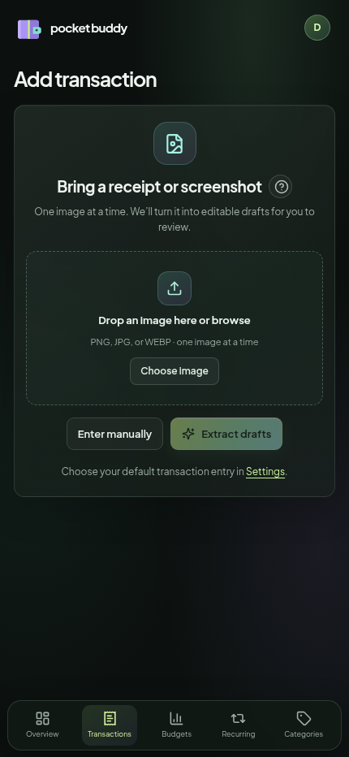
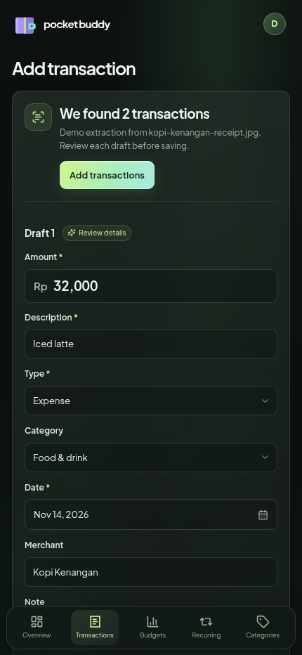
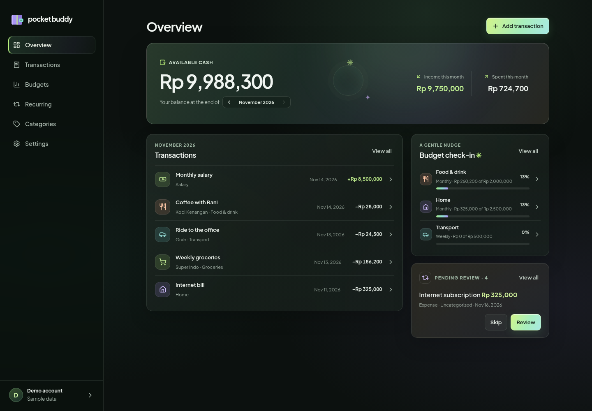
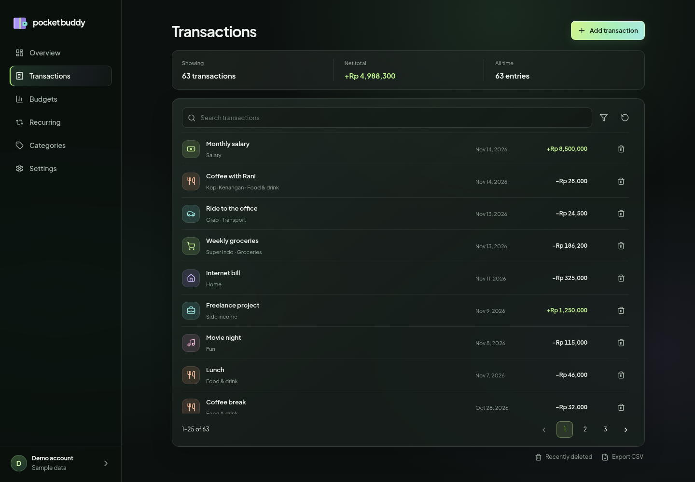
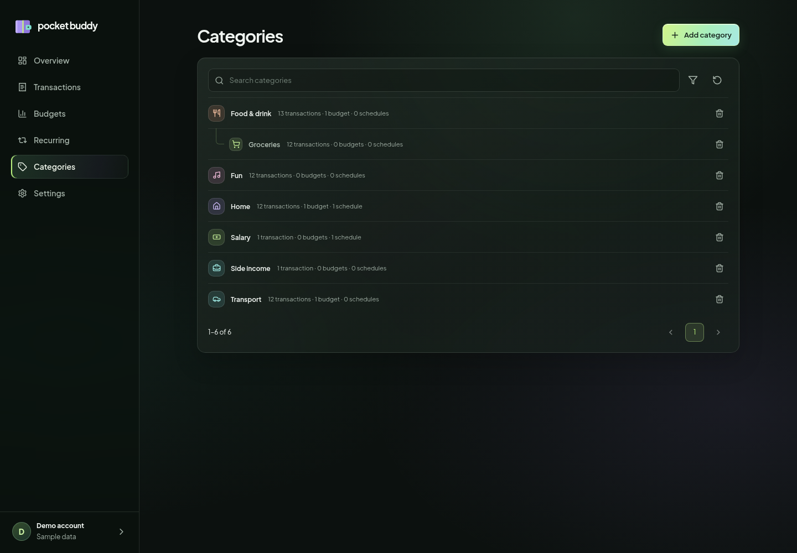
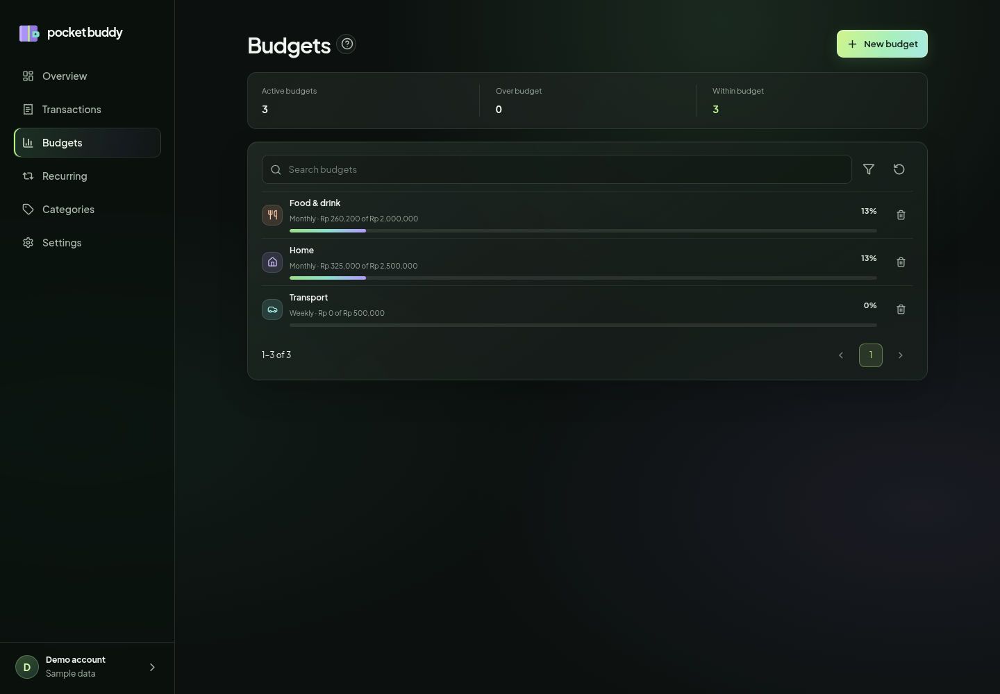
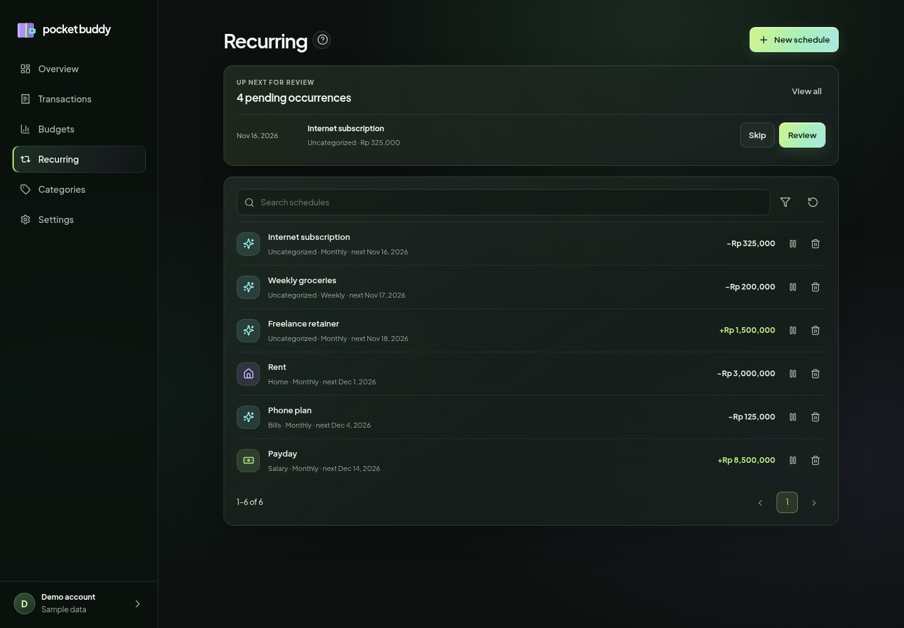
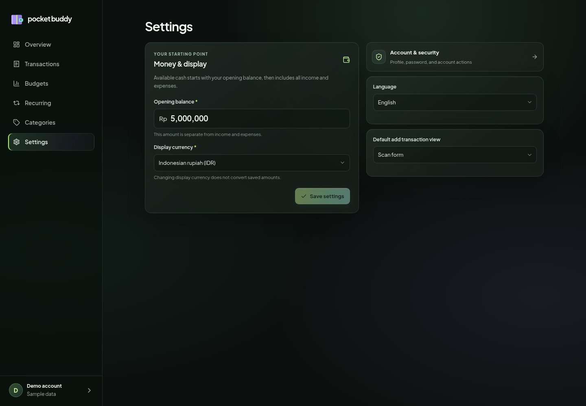

# Pocket Buddy

Pocket Buddy is a personal finance app for tracking everyday income and expenses, understanding cash flow, and keeping spending plans visible. The responsive app brings transactions, budgets, recurring payments, and account preferences together in one place.

## Turn a receipt into ready-to-review transactions

Skip retyping a purchase line by line. Pocket Buddy uses AI-powered receipt scanning to read a screenshot or camera photo and prepare editable transaction drafts. Scan a receipt with multiple items and review each detected transaction before saving it.

Add one receipt or screenshot, then ask Pocket Buddy to extract transaction drafts.

Review each editable draft before saving. These example demo drafts show how to check each amount, description, type, category, date, and merchant, then add only the transactions you want to keep.

<table>
<tr><th>Scan form · Mobile</th><th>Draft review · Mobile</th></tr>
<tr>
<td valign="top"></td>
<td valign="top"></td>
</tr>
</table>

- **AI-assisted extraction:** Gemini analyzes the uploaded image on the server and returns structured transaction details.
- **You stay in control:** review and edit every draft; confirm only the transactions you want to keep.
- **Uncertainty made visible:** drafts with uncertain or missing details are highlighted for review.
- **Privacy-conscious flow:** Pocket Buddy does not retain the uploaded image; only confirmed transactions are saved.
- **Works with mobile capture:** choose an image or take a camera photo, one image at a time.

Receipt scanning uses Gemini for signed-in accounts. Set `GEMINI_API_KEY` in the API environment to enable it. The key stays on the server and is never sent to the browser. The demo account can preview the review experience with sample extraction data.

## More ways to stay on top of your money

### A clear picture of your cash flow

See available cash, income, and spending alongside recent transactions. Monthly summaries help you spot how your cash flow changes over time, while dashboard previews surface budgets and recurring items that need attention.



### Transactions that are easy to manage

Record income or expenses with a date, merchant, notes, and category. Search and filter your history, sort and paginate results, export transactions to CSV, or restore deleted transactions from Recently Deleted for up to 30 days.



### Categories that keep spending organized

Arrange income and expense categories into parent and child groups. Category icons and colors make entries easier to scan, and categories connect transactions, recurring schedules, and budgets.



### Budgets that fit how you organize spending

Create weekly or monthly expense budgets for a category. Organize categories into parent and child groups; child spending rolls up into the parent budget while each budget stays independently visible.



### Recurring payments with a review step

Set weekly, monthly, or yearly schedules for regular income and expenses. Pocket Buddy creates pending occurrences for review, so you can edit or confirm each one before it enters your transaction history.



### Your account, your preferences

Register and verify by email, reset your password, and manage account settings. Choose English or Indonesian separately from your display currency: IDR, USD, SGD, or AUD. New accounts begin with their own empty data, separate from the sample demo account.



## Get started

### Requirements

- Docker with the Compose plugin
- Git

Start Pocket Buddy and its supporting services:

```sh
docker compose up --build
```

Then open the app:

- Web app: <http://localhost:3000>

The API and local email inbox are also available for development and integration work:

- API health: <http://localhost:8080/api/health>
- Mailpit inbox: <http://localhost:8025>

The local Compose setup seeds a verified demo account on first startup:

```text
Email:    demo@pocketbuddy.local
Password: PocketBuddyDemo2026!
```

Use the **Demo** button on the sign-in page to fill the credentials. Configure `DEMO_ACCOUNT_EMAIL` and `DEMO_ACCOUNT_PASSWORD` together to use different local demo credentials. Existing demo account data is not reset or overwritten. Keep demo records synthetic.

New registrations start with an empty account. Verification and password-reset emails are captured in the local Mailpit inbox. To enable signed-in receipt extraction, configure `GEMINI_API_KEY` in the API environment. The key stays server-side. For free-tier experimentation, use synthetic or redacted screenshots only.

> **Existing database:** the API stops rather than applying the initial migration to an unversioned database that already contains Pocket Buddy tables. Read the [database adoption notes](docs/database-adoption.md) before connecting a different existing database.

## Technology

- **Web:** Next.js, React, TypeScript, Mantine
- **API:** Go, Gin, JSON REST
- **Database:** PostgreSQL, GORM, versioned SQL migrations
- **Local services:** Docker Compose and Mailpit
- **Receipt extraction:** Gemini through a server-side provider boundary

The browser talks to the Go API; authentication, validation, business rules, and persistence live on the API. Money is stored as integer minor units with an explicit currency code.

## Checks

```sh
cd apps/web && npm test
cd services/api && go test ./...
```

API database integration tests require `TEST_DATABASE_URL` to point to an isolated disposable PostgreSQL database. Additional local auth and Mailpit checks are documented in the scripts under `scripts/`.

## Project documentation

- [Product scope and delivery status](docs/product.md)
- [Architecture and implementation notes](docs/architecture.md)
- [Design direction](docs/design-direction.md)
- [Security requirements](docs/security.md)
- [Database adoption procedure](docs/database-adoption.md)
- [Demo video source and render instructions](demo-video/README.md)
